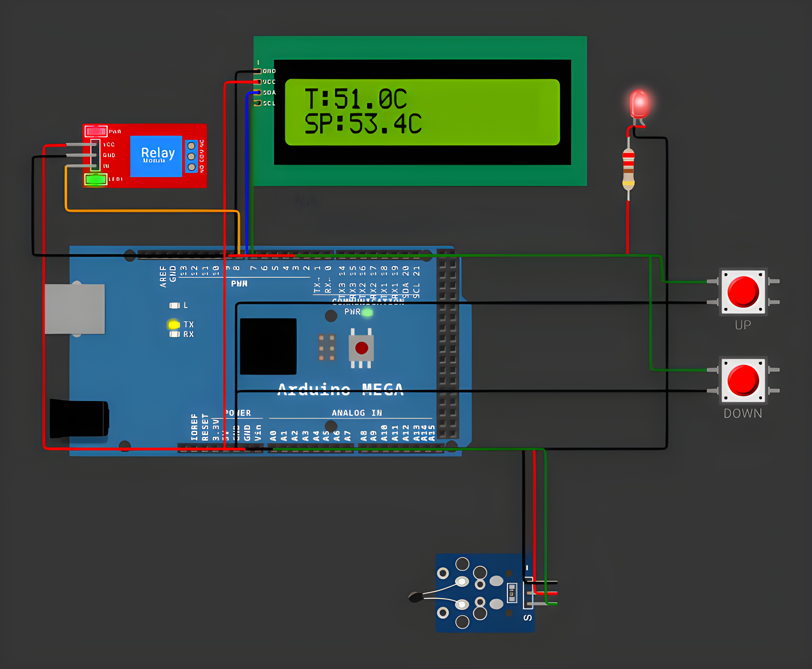

# Hysteresis Control System

<table align="center">
  <tr>
    <td align="center">
      
    </td>
  </tr>
</table>

## Overview

Hysteresis Control System is an embedded application for Arduino Mega that implements an ON-OFF
temperature control with hysteresis, driving a relay actuator based on a user-defined Set Point
and reporting the process state in real time on an LCD and over Serial.

## Features

- **ON-OFF Control with Hysteresis**: Turns the relay ON below `SetPoint - Hysteresis` and OFF
  above `SetPoint + Hysteresis`, keeping the previous state inside the band to avoid frequent
  switching.
- **Set Point Adjustment**: Increases or decreases the Set Point in 0.2 °C steps using the UP and
  DOWN buttons, with software debouncing (50 ms).
- **Real-Time Display**: Shows the current temperature and the Set Point on a 16x2 I2C LCD,
  refreshed every 150 ms.
- **Serial Reporting**: Sends the temperature and Set Point every 500 ms in a format compatible
  with the Arduino Serial Plotter.
- **Status LED**: Mirrors the relay state, providing instant visual feedback.
- **Non-Blocking Execution**: All periodic operations (buttons, sensor, LCD, Serial) are scheduled
  with `millis()`, without `delay()` in the main loop.
- **Clean Architecture**: Sensor, control logic (including relay output), user buttons, and LCD
  display are separated into dedicated components for readability and reuse.

## Technologies

- **Platform**: Arduino Mega
- **Language**: C++ (Arduino Framework)
- **Libraries**: LiquidCrystal_I2C
- **Build System**: PlatformIO
- **Simulation**: Wokwi
- **Development Tools**: Visual Studio Code + PlatformIO IDE
- **Version Control**: Git, GitHub

## Project Structure

```
src/
├── buttons/
│   ├── buttons.cpp
│   └── buttons.h
├── control/
│   ├── control.cpp
│   └── control.h
├── sensor/
│   ├── sensor.cpp
│   └── sensor.h
├── ui_lcd/
│   ├── ui_lcd.cpp
│   └── ui_lcd.h
└── main.cpp
diagram.json
wokwi.toml
platformio.ini
```

## Control Logic

With the default values (`SetPoint = 30.0`, `Hysteresis = 1.0`):

| Temperature | Relay state |
|---|---|
| Below 29.0 | ON |
| Between 29.0 and 31.0 | Keeps the previous state |
| Above 31.0 | OFF |

## Pin Mapping

| Component | Pin | Action |
|---|---|---|
| Temperature sensor | A0 | Analog temperature input |
| BTN_UP | 2 | Increases the Set Point by 0.2 °C |
| BTN_DOWN | 3 | Decreases the Set Point by 0.2 °C |
| Relay | 8 | Switches the heating element |
| LED | 9 | Reflects the relay state |
| LCD (I2C, 0x27) | SDA 20 / SCL 21 | Displays temperature and Set Point |

## Resources

- [Wokwi Documentation](https://docs.wokwi.com/)
- [PlatformIO Documentation](https://docs.platformio.org/)
- [Arduino millis() Reference](https://www.arduino.cc/reference/en/language/functions/time/millis/)
- [LiquidCrystal_I2C Library](https://github.com/marcoschwartz/LiquidCrystal_I2C)

## Installation

To build and run the application, follow these steps:

1. **Clone this repository:**
```bash
git clone https://github.com/Constantin-Stamate/hysteresis-control-system
```

2. **Navigate to the project directory:**
```bash
cd hysteresis-control-system
```

3. **Open the project in VS Code with the PlatformIO extension installed**

4. **Build and upload to the board (or run the Wokwi simulation):**
```bash
pio run --target upload
```

5. **Interact with the system:**
```
BTN_UP   -> increases the Set Point
BTN_DOWN -> decreases the Set Point
Sensor   -> change the temperature (in Wokwi, click the sensor and move the slider)
```

6. **Observe the result:** the relay and the LED switch according to the hysteresis band, while
the LCD and the Serial Monitor display the temperature and the Set Point.

## Contributors

**Hysteresis Control System** was developed as part of the Internet of Things laboratory works.

- GitHub: [Constantin-Stamate](https://github.com/Constantin-Stamate)
- Email: constantinstamate.r@gmail.com